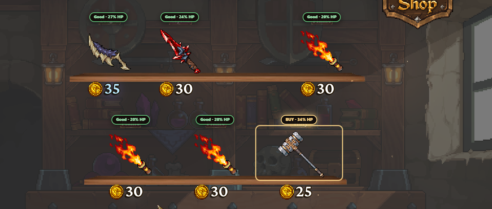
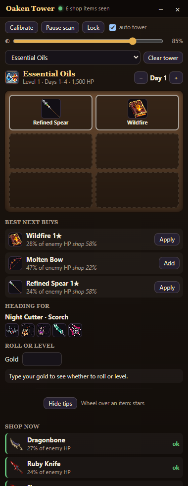
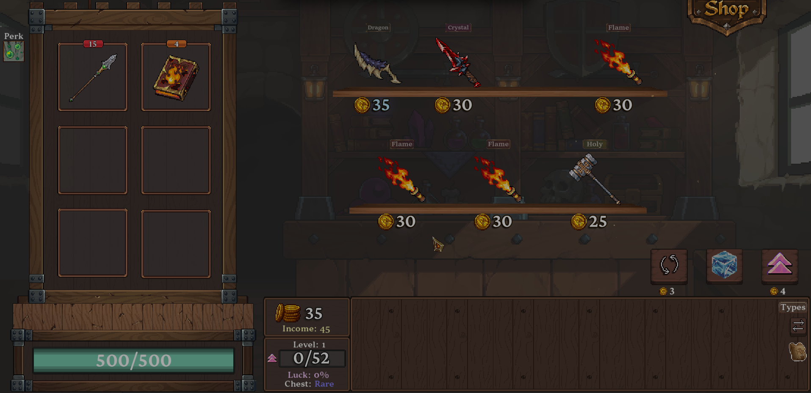

# Oaken Tower Overlay

**Dein Plan und Kauf-Tipps direkt über dem Spiel.** Inoffizielles Fan-Tool zu _Oaken Tower_, Begleiter zum [Oaken Tower Fan Hub](https://oaken.hallodasevent.de).



## Was das Tool kann

- **Shop-Tipps im Spiel:** Über jedem Shop-Item steht **BUY**, **Good** oder **Skip**, mit dem Effekt auf deinen Turm (simuliert). Das beste Item ist golden umrahmt.
- **Dein Turm wird erkannt** und automatisch eingetragen (auch die im Spiel gespiegelten Bilder).
- **Panel über dem Spiel:** Turm, beste nächste Käufe, Ziel-Build, Roll oder Level. Verschiebbar, **durchsichtig einstellbar (20–100 %)**, sperrbar (Klicks gehen durch zum Spiel).
- **Live mit dem Planner der Website verbunden:** Änderungen erscheinen sofort auf beiden Seiten.



## Einrichten

1. `OakenTowerOverlay-x.y.z.exe` starten (keine Installation). Das Spiel im Fenster- oder randlosen Modus spielen.
2. Einen Shop öffnen, **Strg+Umschalt+K**: pro Shop-Reihe einen Rahmen ziehen, dann den Turm. Speichern.



| Kürzel | Wirkung |
|---|---|
| Strg+Umschalt+O | Ein- / ausblenden |
| Strg+Umschalt+L | Panel sperren (Klicks gehen durch) |
| Strg+Umschalt+K | Kalibrieren |
| Strg+Umschalt+S | Shop-Scan an / aus |
| Strg+Umschalt+↑ / ↓ | Panel weniger / mehr durchsichtig |

## Was das Tool sieht

Es macht etwa alle 1,5 s ein Bildschirmfoto und vergleicht nur die kalibrierten Ausschnitte mit den Item-Bildern, **auf deinem PC**. Kein Zugriff auf Speicher oder Dateien des Spiels, nichts wird hochgeladen. Die Verbindung zum Planner läuft nur lokal (`127.0.0.1`).

## Entwickeln

```bash
npm install
npm start        # bauen und starten
npm test         # Erkennung, auch an echten Spiel-Ausschnitten
npm run dist     # portable .exe nach release/
npm run sync     # Simulator, Daten und Bilder aus dem Hub nach shared/ (HUB_DIR=../oaken-tower-hub)
```

`shared/` ist eine Kopie der benötigten Teile des Fan Hubs (Simulator, Spieldaten, Overlay-Anzeige, Item-Bilder). Item-Bilder und Spielinhalte gehören den Entwicklern von _Oaken Tower_.

**In Arbeit:** Auslesen der Spielanzeigen (Tag, Gold, Level, XP, Luck, Chest, Shop-Chancen, Leben, Trophäen, Perk) – `renderer/hud.ts`, `renderer/ocr.ts`.
